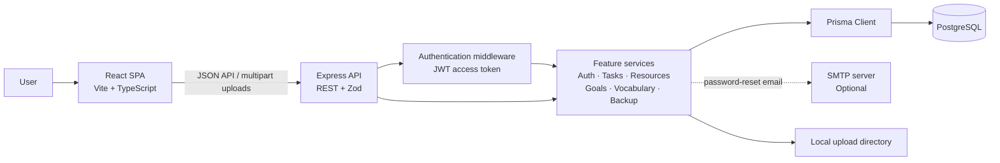
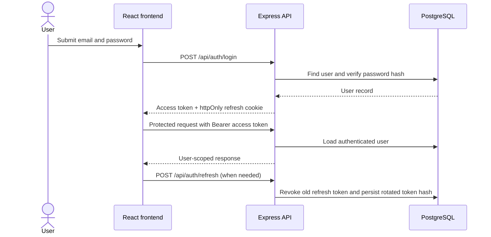
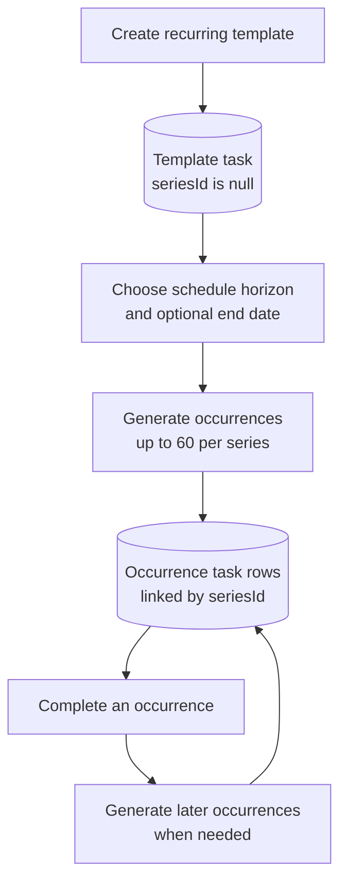

<div align="center">

---

## Contents

- [Features](#-features)
- [Technology stack](#-technology-stack)
- [Application architecture](#-application-architecture)
- [Project structure](#-project-structure)
- [Prerequisites](#-prerequisites)
- [Installation and setup](#-installation-and-setup)
- [Environment variables](#-environment-variables)
- [Application workflows](#-application-workflows)
- [API reference](#-api-reference)
- [Testing and quality assurance](#-testing-and-quality-assurance)
- [Security](#-security)
- [Deployment](#-deployment)
- [Troubleshooting](#-troubleshooting)
- [Roadmap](#-roadmap)
- [Contributing](#-contributing)
- [License](#-license)
- [Author](#-author)

## ✨ Features

| Area                              | What Aura provides                                                                                                                                                                                                                        |
| --------------------------------- | ----------------------------------------------------------------------------------------------------------------------------------------------------------------------------------------------------------------------------------------- |
| 🔐 **Accounts and profile** | Registration, sign-in/out, access-token refresh, password change/reset, profile details, avatar upload, and light/dark theme preference.                                                                                                  |
| ✅ **Tasks**                | Create, filter, search, update, complete, and delete tasks; manage priority, status, categories, dates, times, notes, links, and task attachments.                                                                                        |
| 🔁 **Recurring tasks**      | Daily, weekly, monthly, and yearly schedules with an interval and optional end date. Aura materializes occurrences up to a three-month horizon, capped at 60 occurrences; completing a scheduled occurrence can extend the series.        |
| 🗓️ **Calendar**           | Month calendar displaying task schedules and supporting task creation for a selected day.                                                                                                                                                 |
| 📚 **Resources**            | Save links, notes, and uploaded files, optionally organized with categories. Upload types and file sizes are restricted by the backend.                                                                                                   |
| 🇬🇧 **English vocabulary** | Maintain personal words with meanings, examples, pronunciation, categories, favorites, and learned status; review a word of the day.                                                                                                      |
| 🧠 **Quizzes**              | Generate vocabulary questions by learning status or favorites, submit answers, and review quiz history.                                                                                                                                   |
| 🎯 **Goals**                | Create and update goals, track progress from 0–100%, and manage active, completed, and archived statuses.                                                                                                                                |
| 📊 **Statistics**           | View dashboard and task/productivity/vocabulary statistics, including chart-ready summaries and quiz history.                                                                                                                             |
| 🔎 **Search and reminders** | Search across personal content and review overdue, due-today, due-tomorrow, and upcoming task reminders.                                                                                                                                  |
| 📦 **Backup**               | Export personal records as JSON or selected tables as CSV; restore supported JSON records. Restore checks for duplicates for categories and vocabulary words. JSON exports do not package uploaded file contents or task attachment rows. |

> [!NOTE]
> These capabilities are documented from the routes, pages, and services in the
> repository. A feature list is not a claim of complete automated or end-to-end
> test coverage.

## 🛠️ Technology stack

| Layer                                 | Technologies                                                                                                                                                                                       |
| ------------------------------------- | -------------------------------------------------------------------------------------------------------------------------------------------------------------------------------------------------- |
| **Frontend**                    | React 18, TypeScript, Vite 6, Tailwind CSS 3, React Router 6, TanStack Query, Axios, Recharts, Lucide React                                                                                        |
| **Backend**                     | Node.js 20+, Express 4, TypeScript, Zod validation                                                                                                                                                 |
| **Database / ORM**              | PostgreSQL 16+, Prisma ORM and Prisma Client 6                                                                                                                                                     |
| **Authentication and security** | JWT access tokens, rotating opaque refresh tokens stored as hashes, `httpOnly` refresh cookie, bcryptjs password hashing, Helmet, CORS allowlist, express-rate-limit, Multer upload restrictions |
| **Testing and development**     | Jest, ts-jest, Supertest, TypeScript, tsx, GitHub Actions                                                                                                                                          |
| **Optional email**              | Nodemailer and an SMTP server for password-reset delivery                                                                                                                                          |

## 🏗️ Application architecture



The frontend calls the backend under `/api`. During local development, Vite
proxies `/api` and `/uploads` to the backend on port `5000`. In a deployed
frontend, `VITE_API_URL` can point the SPA to the API origin.

Protected feature routers require a bearer access token. Authentication
endpoints issue a short-lived access token and a rotating refresh token in an
`httpOnly` cookie. The backend scopes application records to the authenticated
user and persists them through Prisma to PostgreSQL. Uploaded assets are stored
in the configured upload directory and served from the `/uploads` path.

## 📂 Project structure

```text
.
├── .github/
│   └── workflows/
│       ├── ci.yml                 # Backend tests/typecheck and frontend checks
│       └── pages.yml              # Frontend GitHub Pages deployment
├── backend/
│   ├── prisma/
│   │   ├── migrations/            # Versioned PostgreSQL schema migrations
│   │   ├── schema.prisma          # Database models and relations
│   │   └── seed.ts                # Optional demo data seed
│   ├── src/
│   │   ├── config/                # Environment validation
│   │   ├── lib/                   # Prisma client
│   │   ├── middlewares/           # Auth, validation, uploads, errors, limits
│   │   ├── modules/               # Feature routes, controllers, services
│   │   ├── utils/                 # Shared helpers
│   │   ├── app.ts                 # Express app and route registration
│   │   └── index.ts               # API process entry point
│   ├── tests/                     # Jest/Supertest backend tests
│   ├── .env.example               # Backend environment template
│   ├── Dockerfile                 # Backend container build
│   └── package.json
├── frontend/
│   ├── src/
│   │   ├── api/                   # API client and request helpers
│   │   ├── auth/                  # Client authentication state
│   │   ├── components/            # Shared UI, layout, and feature components
│   │   ├── pages/                 # SPA routes and screens
│   │   └── App.tsx                # Browser routes and providers
│   ├── .env.example               # Optional frontend environment template
│   ├── vite.config.ts             # Vite, aliases, and local API proxies
│   └── package.json
├── scripts/
│   ├── start-db.ps1               # Start the documented local PostgreSQL cluster
│   └── stop-db.ps1                # Stop that local cluster
├── render.yaml                    # Render API/database deployment blueprint
└── README.md
```

## ⚙️ Prerequisites

- **Node.js 20 or later** and npm. CI currently uses Node.js 22.
- **PostgreSQL 16 or later** reachable by the backend.
- Git to clone the repository.
- A terminal with access to the project directory.

For local Windows PostgreSQL start/stop helper scripts, see
[`scripts/`](./scripts/). The scripts expect a locally installed PostgreSQL
instance and its data directory to be configured for the machine; inspect them
before use and do not point them at production data.

## 🚀 Installation and setup

### 1. Get the source

Use the clone URL for your own repository:

```bash
git clone <repository-url> aura
cd aura
```

This project has separate `backend/` and `frontend/` npm projects; there is no
root `package.json`.

### 2. Configure PostgreSQL

Create a PostgreSQL database and a database role for Aura. Use a dedicated
local development database rather than a production database. Ensure the role
has the privileges needed by the application and migrations.

For example, after connecting to PostgreSQL as an administrator, create a
database and role using your own secure local password:

```sql
CREATE ROLE aura_app LOGIN PASSWORD '<choose-a-local-password>';
CREATE DATABASE aura OWNER aura_app;
```

If you prefer to administer grants separately, grant the application role
access to the database and schema. Keep credentials local and do not commit
them.

### 3. Install and configure the backend

```bash
cd backend
npm ci
```

Copy the environment template to `.env` and replace the example values:

```bash
# macOS / Linux
cp .env.example .env

# Windows PowerShell (run instead of the command above)
Copy-Item .env.example .env
```

At minimum, set `DATABASE_URL`, `JWT_ACCESS_SECRET`, and
`JWT_REFRESH_SECRET`. Generate independent, high-entropy secrets for both JWT
keys; the sample values in `.env.example` are placeholders and must not be
used in production.

Generate the Prisma Client and apply the checked-in migrations:

```bash
npx prisma generate
npm run db:migrate
```

`db:migrate` runs `prisma migrate deploy`, which applies pending migrations and
does not reset the database.

To create optional demo/sample data in a development database:

```bash
npm run db:seed
```

The seed is intended for development. It creates or updates demo content in
the database selected by `DATABASE_URL`; do not run it against production.

### 4. Install the frontend

Open a second terminal at the repository root:

```bash
cd frontend
npm ci
```

For local development, no frontend environment file is required. Vite proxies
the same-origin `/api` and `/uploads` paths to `http://localhost:5000`.

### 5. Run the application

Start the backend in the first terminal:

```bash
cd backend
npm run dev
```

Start the frontend in the second terminal:

```bash
cd frontend
npm run dev
```

Open **[http://localhost:5173/](http://localhost:5173/)**. The API health endpoint is
**[http://localhost:5000/api/health](http://localhost:5000/api/health)**.

> [!TIP]
> On Windows, if PowerShell blocks `npm.ps1` due to execution policy, run
> `npm.cmd` in place of `npm` for the commands above, or use a terminal whose
> execution policy permits the npm command shim. Do not change machine-wide
> policy solely for this project.

## 🔐 Environment variables

### Backend

The backend validates environment values at startup in
[`backend/src/config/env.ts`](./backend/src/config/env.ts). `DATABASE_URL`,
`JWT_ACCESS_SECRET`, and `JWT_REFRESH_SECRET` are required. Other values have
code-defined defaults and may be overridden as needed.

| Variable                   |      Required | Purpose                                            | Safe example / default                                                 |
| -------------------------- | ------------: | -------------------------------------------------- | ---------------------------------------------------------------------- |
| `NODE_ENV`               |            No | Runtime mode                                       | `development`                                                        |
| `PORT`                   |            No | Express listening port                             | `5000`                                                               |
| `DATABASE_URL`           | **Yes** | PostgreSQL connection string                       | `postgresql://aura_app:<password>@localhost:5432/aura?schema=public` |
| `JWT_ACCESS_SECRET`      | **Yes** | Signs access JWTs; minimum 16 characters           | `<generate-a-long-random-secret>`                                    |
| `JWT_REFRESH_SECRET`     | **Yes** | Key used by token/reset hashing utilities          | `<generate-a-different-long-random-secret>`                          |
| `JWT_ACCESS_EXPIRES_IN`  |            No | Access token lifetime                              | `15m`                                                                |
| `JWT_REFRESH_EXPIRES_IN` |            No | Refresh-token lifetime                             | `30d`                                                                |
| `CLIENT_URL`             |            No | Frontend origin used to construct reset links      | `http://localhost:5173`                                              |
| `API_URL`                |            No | API URL printed at startup                         | `http://localhost:5000`                                              |
| `CORS_ORIGIN`            |            No | Comma-separated allowed browser origins            | `http://localhost:5173`                                              |
| `SMTP_HOST`              |            No | SMTP server hostname; blank disables SMTP delivery | blank                                                                  |
| `SMTP_PORT`              |            No | SMTP server port                                   | `587`                                                                |
| `SMTP_SECURE`            |            No | SMTP TLS mode                                      | `false`                                                              |
| `SMTP_USER`              |            No | SMTP username                                      | blank                                                                  |
| `SMTP_PASS`              |            No | SMTP password                                      | blank                                                                  |
| `MAIL_FROM`              |            No | Sender address for reset email                     | `Aura <noreply@example.com>`                                         |
| `UPLOAD_DIR`             |            No | Local upload root                                  | `uploads`                                                            |
| `MAX_FILE_SIZE_MB`       |            No | Maximum accepted upload size in MiB                | `10`                                                                 |
| `RATE_LIMIT_WINDOW_MS`   |            No | General API rate-limit window                      | `900000`                                                             |
| `RATE_LIMIT_MAX`         |            No | General requests allowed per window                | `200`                                                                |

`DATABASE_URL` must be a valid PostgreSQL URL. URL-encode special characters
in database usernames or passwords. The required environment variables must
also be set in production; do not use the sample secrets from `.env.example`.

When SMTP is not configured, password-reset requests remain generic to avoid
revealing whether an email exists; in non-production mode the API can return a
development reset URL to support local testing. The development mail helper
also logs message content, including reset links, to the backend console; keep
those logs private and never enable this behavior for production workflows.

### Frontend

| Variable           | Required | Purpose                                                                     | Example                     |
| ------------------ | -------: | --------------------------------------------------------------------------- | --------------------------- |
| `VITE_API_URL`   |       No | API origin for a separately hosted backend; blank uses same-origin `/api` | `https://api.example.com` |
| `VITE_BASE_PATH` |       No | Vite base path for hosting under a subdirectory                             | `/my-repository/`         |

`VITE_*` values are embedded into the browser bundle and are **not secrets**.
Never place passwords, private keys, or tokens in frontend environment
variables.

## 🗺️ Application workflows

### Authentication and protected requests



### Recurring task materialization



## 🔌 API reference

All endpoints are prefixed with `/api`. Except for the health endpoint and
public authentication actions, routes require:

```http
Authorization: Bearer <access-token>
```

Authentication responses also set the `aura_refresh` refresh token as an
`httpOnly` cookie. Successful JSON responses generally use
`{ "success": true, "data": ... }`; errors use
`{ "success": false, "error": { "code": "...", "message": "..." } }`.

### Health

| Method  | Endpoint        | Purpose                                | Authentication |
| ------- | --------------- | -------------------------------------- | -------------- |
| `GET` | `/api/health` | Reports API status and process uptime. | No             |

### Authentication

| Method    | Endpoint                      | Purpose                                                            | Authentication |
| --------- | ----------------------------- | ------------------------------------------------------------------ | -------------- |
| `POST`  | `/api/auth/register`        | Create an account; body: `name`, `email`, `password`.        | No             |
| `POST`  | `/api/auth/login`           | Sign in; body: `email`, `password`.                            | No             |
| `POST`  | `/api/auth/logout`          | Revoke the refresh session and clear its cookie.                   | No             |
| `POST`  | `/api/auth/refresh`         | Rotate the refresh cookie and issue a new access token.            | Refresh cookie |
| `POST`  | `/api/auth/forgot-password` | Request a password-reset link; body: `email`.                    | No             |
| `POST`  | `/api/auth/reset-password`  | Set a new password; body: `token`, `password`.                 | No             |
| `GET`   | `/api/auth/me`              | Return the authenticated user's safe profile.                      | Yes            |
| `POST`  | `/api/auth/change-password` | Change password; body: `currentPassword`, `newPassword`.       | Yes            |
| `PATCH` | `/api/auth/profile`         | Update profile name/theme; may include multipart `profileImage`. | Yes            |

### Tasks and categories

| Method     | Endpoint                                     | Purpose                                                                                                                                            | Authentication |
| ---------- | -------------------------------------------- | -------------------------------------------------------------------------------------------------------------------------------------------------- | -------------- |
| `GET`    | `/api/tasks`                               | List/filter tasks. Query supports `status`, `priority`, `categoryId`, `q`, `dueFrom`, `dueTo`, `completed`, `page`, and `limit`. | Yes            |
| `POST`   | `/api/tasks`                               | Create a task or recurring template.                                                                                                               | Yes            |
| `GET`    | `/api/tasks/:id`                           | Read a task; recurring templates include their materialized occurrences.                                                                           | Yes            |
| `PUT`    | `/api/tasks/:id`                           | Update a task; recurring updates accept `applyTo: "this" \| "series"`.                                                                            | Yes            |
| `PATCH`  | `/api/tasks/:id/complete`                  | Complete or reopen a task; body may set `completed` to a boolean.                                                                                | Yes            |
| `DELETE` | `/api/tasks/:id`                           | Delete a task; recurring occurrences may use query `mode=series`.                                                                                | Yes            |
| `POST`   | `/api/tasks/:id/attachments`               | Upload one task attachment as multipart field `file`.                                                                                            | Yes            |
| `DELETE` | `/api/tasks/:id/attachments/:attachmentId` | Remove a task attachment.                                                                                                                          | Yes            |
| `GET`    | `/api/categories`                          | List the authenticated user's categories.                                                                                                          | Yes            |
| `POST`   | `/api/categories`                          | Create a category.                                                                                                                                 | Yes            |
| `PUT`    | `/api/categories/:id`                      | Update a category.                                                                                                                                 | Yes            |
| `DELETE` | `/api/categories/:id`                      | Delete a category.                                                                                                                                 | Yes            |

All task and category endpoints above require authentication. Task status values
are `PENDING`, `IN_PROGRESS`, and `COMPLETED`; priorities are `LOW`, `MEDIUM`,
`HIGH`, and `URGENT`; recurrence values are `NONE`, `DAILY`, `WEEKLY`,
`MONTHLY`, and `YEARLY`.

Example task request:

```http
POST /api/tasks
Authorization: Bearer <access-token>
Content-Type: application/json
```

```json
{
  "title": "Review project notes",
  "priority": "MEDIUM",
  "status": "PENDING",
  "dueDate": "2026-11-15",
  "recurrence": "NONE"
}
```

### Resources

| Method     | Endpoint               | Purpose                                                                                  | Authentication |
| ---------- | ---------------------- | ---------------------------------------------------------------------------------------- | -------------- |
| `GET`    | `/api/resources`     | List resources; query supports `type`, `categoryId`, `q`, `page`, and `limit`. | Yes            |
| `POST`   | `/api/resources`     | Create a link/note or upload a file; file field is `file`.                             | Yes            |
| `PUT`    | `/api/resources/:id` | Update resource details or replace its uploaded file.                                    | Yes            |
| `DELETE` | `/api/resources/:id` | Delete a resource and attempt to remove its stored file.                                 | Yes            |

### English vocabulary and quizzes

| Method     | Endpoint                           | Purpose                                                                                                           | Authentication |
| ---------- | ---------------------------------- | ----------------------------------------------------------------------------------------------------------------- | -------------- |
| `GET`    | `/api/english/words`             | List/search/filter words. Query includes `q`, `category`, `favorite`, `learned`, `page`, and `limit`. | Yes            |
| `GET`    | `/api/english/words/categories`  | List vocabulary categories.                                                                                       | Yes            |
| `GET`    | `/api/english/words/word-of-day` | Retrieve the word-of-day result.                                                                                  | Yes            |
| `POST`   | `/api/english/words`             | Create a word.                                                                                                    | Yes            |
| `PUT`    | `/api/english/words/:id`         | Update a word.                                                                                                    | Yes            |
| `PATCH`  | `/api/english/words/:id/learned` | Update learned/favorite flags.                                                                                    | Yes            |
| `DELETE` | `/api/english/words/:id`         | Delete a word.                                                                                                    | Yes            |
| `GET`    | `/api/english/quiz/questions`    | Generate questions; query supports `count` and `mode`.                                                        | Yes            |
| `POST`   | `/api/english/quiz/submit`       | Submit quiz totals and answer details.                                                                            | Yes            |
| `GET`    | `/api/english/quiz/history`      | Retrieve quiz history.                                                                                            | Yes            |

### Goals, statistics, search, notifications, and backup

| Method     | Endpoint                          | Purpose                                                                          | Authentication |
| ---------- | --------------------------------- | -------------------------------------------------------------------------------- | -------------- |
| `GET`    | `/api/goals`                    | List goals; query supports `status`, `q`, `page`, and `limit`.           | Yes            |
| `POST`   | `/api/goals`                    | Create a goal.                                                                   | Yes            |
| `PUT`    | `/api/goals/:id`                | Update a goal.                                                                   | Yes            |
| `DELETE` | `/api/goals/:id`                | Delete a goal.                                                                   | Yes            |
| `GET`    | `/api/statistics/dashboard`     | Dashboard summaries.                                                             | Yes            |
| `GET`    | `/api/statistics/tasks`         | Task statistics.                                                                 | Yes            |
| `GET`    | `/api/statistics/productivity`  | Productivity summaries.                                                          | Yes            |
| `GET`    | `/api/statistics/vocabulary`    | Vocabulary and quiz statistics.                                                  | Yes            |
| `GET`    | `/api/search`                   | Search personal content; accepts `q`, optional `types`, and `limit`.       | Yes            |
| `GET`    | `/api/notifications`            | Return task reminders.                                                           | Yes            |
| `GET`    | `/api/backup/export`            | Export JSON backup for the current user.                                         | Yes            |
| `GET`    | `/api/backup/export/:table/csv` | Export `tasks`, `categories`, `resources`, `words`, or `goals` as CSV. | Yes            |
| `POST`   | `/api/backup/restore`           | Restore supported records from a JSON backup body.                               | Yes            |

## 🧪 Testing and quality assurance

Run backend checks from `backend/`:

```bash
npm run typecheck
npm test
```

The backend suite uses Jest, ts-jest, and Supertest. Its global setup
**force-resets the test database before running**. The checked-in setup targets
a database named `aura_test`; confirm that this database is disposable and
contains no data you need before running `npm test`. The suite's runtime setup
also sets `DATABASE_URL` to `aura_test`, so changing only `TEST_DATABASE_URL`
can make setup and test runtime point at different databases. Never point
either URL at development or production data.

Run frontend checks from `frontend/`:

```bash
npm run typecheck
npm run build
```

The frontend build runs TypeScript checking before creating `frontend/dist`.
There is currently no frontend test script and no lint script/configuration in
the package manifests. CI runs backend type checking and tests, plus frontend
type checking and a production build; this does not constitute full browser
end-to-end coverage.

## 🔒 Security

- Protected feature routes validate bearer access tokens and use the
  authenticated user ID for user-owned records.
- Passwords are hashed with bcryptjs. Refresh tokens are opaque, rotated, and
  stored as hashes; the raw refresh token is sent using an `httpOnly` cookie.
- Zod schemas validate request bodies and selected query parameters.
- Helmet provides security headers; CORS is configured with an origin
  allowlist; rate limiters are applied to API and authentication requests.
- Uploads have a configured size limit and an allowlist of MIME types; active
  content extensions such as HTML and SVG are rejected.
- Keep `.env` files and production secrets out of source control. Use distinct,
  high-entropy JWT secrets and a least-privilege database role.
- Use HTTPS in production. Cross-site refresh cookies require secure transport.
- Store uploaded files on durable storage in production if the hosting
  platform's filesystem is ephemeral. The repository uses local disk uploads;
  a cloud object-storage integration is not configured here.

> [!WARNING]
> Security controls reduce risk but do not guarantee that an application is
> secure. Review deployment networking, database backups, secret rotation,
> monitoring, and upload storage before exposing a production service.

## 🚢 Deployment

The repository includes a Render blueprint in [`render.yaml`](./render.yaml),
a backend [`Dockerfile`](./backend/Dockerfile), and a GitHub Actions workflow
for deploying the **frontend** to GitHub Pages.

### Backend and PostgreSQL

The Render blueprint describes a PostgreSQL database and Node web service. Set
the production `DATABASE_URL`, `JWT_ACCESS_SECRET`, `JWT_REFRESH_SECRET`,
`CORS_ORIGIN`, `CLIENT_URL`, and `API_URL` through the hosting provider's
environment configuration. The backend's container/start commands run
`prisma migrate deploy` before starting the API.

Do not run `prisma db push --force-reset` against production. Use the checked-in
Prisma migrations and back up the database before operational schema changes.
Persistent storage must be configured if uploaded files need to survive
container replacement.

### Frontend on GitHub Pages

The `.github/workflows/pages.yml` workflow builds the frontend and deploys it
when run on the configured repository. It sets the Pages base path from the
repository name. Configure the GitHub Actions repository variable
`VITE_API_URL` with the public API origin; that origin must allow the deployed
frontend in `CORS_ORIGIN`. `CLIENT_URL` should be the public frontend URL used
to construct password-reset links. For cross-site auth, production refresh
cookies use `SameSite=None; Secure`, so both frontend and backend must be served
over HTTPS.

The backend is not hosted by GitHub Pages. No deployment has been performed or
verified by this README.

## 🛠️ Troubleshooting

| Symptom                                          | Checks                                                                                                                                                                                                                            |
| ------------------------------------------------ | --------------------------------------------------------------------------------------------------------------------------------------------------------------------------------------------------------------------------------- |
| Backend cannot connect to PostgreSQL             | Confirm the database is running and reachable; verify `DATABASE_URL`, database name, username/password, host, port, URL-encoded credentials, and database grants. Never paste the connection string into public logs or issues. |
| Prisma reports unapplied migrations              | From `backend/`, run `npx prisma generate` and `npm run db:migrate` against the intended development database. Do not use a reset command to repair a database containing data you need.                                    |
| Backend exits with invalid environment variables | Ensure `backend/.env` exists and contains `DATABASE_URL`, `JWT_ACCESS_SECRET`, and `JWT_REFRESH_SECRET`; both secrets must be at least 16 characters.                                                                     |
| Port 5000 is already in use                      | Stop or reconfigure the process that owns the port, or set backend `PORT` and update `frontend/vite.config.ts` proxy target to match.                                                                                         |
| Frontend loads but API requests fail             | Ensure the backend is running on port 5000 and check the Vite `/api` and `/uploads` proxy. For a separately hosted API, set frontend `VITE_API_URL` and configure backend `CORS_ORIGIN`.                                  |
| Login or refresh repeatedly fails                | Check backend and database logs, JWT secrets, browser cookie settings, and HTTPS/SameSite configuration. In production, use HTTPS and the correct frontend/API origins.                                                           |
| Backend tests fail to connect or affect data     | Ensure PostgreSQL is available and the test URL points only to a disposable `aura_test` database. The test setup force-resets its target before execution.                                                                      |
| Package install fails                            | Use a supported Node.js/npm version and run `npm ci` inside the relevant app directory (`backend/` or `frontend/`).                                                                                                         |

## 🗺️ Roadmap

The repository does not currently maintain a formal roadmap. Features not
implemented in the source are intentionally not presented here as committed
plans.

## 🤝 Contributing

Contributions are welcome. Before opening a pull request:

1. Keep changes focused and preserve existing behavior.
2. Install dependencies with `npm ci` in the affected app directory.
3. Run backend tests/type checking or frontend type checking/build as relevant.
4. For backend tests, use only the dedicated disposable test database because
   the suite resets its configured target.
5. Include tests for behavior changes and describe any configuration or
   migration requirements.
6. Never include `.env` files, credentials, user data, or generated build
   output in a contribution.

## 📄 License

No license file is present in this repository. Unless a license is added, the
repository does not communicate an open-source license grant; obtain permission
from the copyright holder before redistributing or reusing the code.

## 👤 Author

**Kareem Ahmed**
